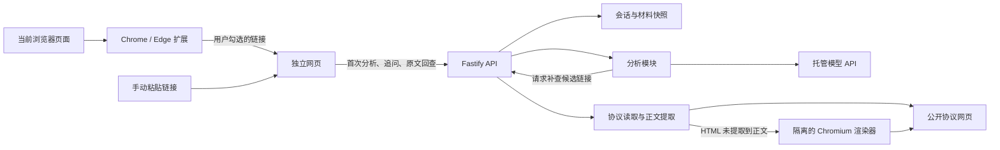

# 用户协议分析 Agent 首版架构

## 产品范围

用户提交一个或多个软件协议链接，再提出与自身情况有关的问题。网页给出适用条件、平台可做什么、对用户的影响、可选行动和待确认事项。用户可以打开引文对应的原文段落，也可以补充情况和协议链接继续追问。

首版先进行小范围内测，用户打开网页即可提交问题。界面和回答使用中文，材料范围为公开的中英文网页，重点覆盖隐私和内容授权。协议更新复核属于后续版本。模块负责人、数据格式和联调样例见[分工与接口规格](interface-spec.md)。

## 系统组成

| 模块 | 职责 | 负责人 |
| --- | --- | --- |
| 浏览器扩展 | 用户点击后扫描主页面已渲染且带地址的链接，供用户勾选并跳转到独立网页。 | Alice |
| 独立网页 | 用 React 和 Vite 实现直接输入或导入链接、提问、回答展示、原文定位、追问和反馈入口。 | Alice |
| 后端服务 | 用 Fastify 管理请求和会话，读取网页、提取材料、约束补查、核对引文并保存对话。 | Carol |
| 分析模块 | 在后端进程内运行，理解问题、选择相关材料和补查目标、调用托管模型并生成结构化回答草稿。 | Bob |

各模块统一使用 TypeScript。扩展只交接用户选中的协议 URL，当前页面正文和登录状态保留在浏览器中。独立网页接收导入链接并填入可编辑表单，用户提交后才开始分析。主页面中新渲染的链接可以通过再次扫描发现。跨域嵌入页面和没有链接地址的按钮属于首版扫描边界。

## 一轮分析的流程

1. 后端接收协议链接和问题，先读取公开 HTML。正文提取失败时，交给隔离的 Chromium 渲染。提取结果包含标题、最终来源链接、章节、段落和候选关联链接，文档和段落 ID 在同一对话内保持稳定。
2. 分析模块根据问题筛选段落，按需从已发现的候选链接中选择补查目标。后端按配置限制每次提交的补查轮次和新 URL 读取额度。读取额度涵盖用户提交的链接、补查链接和失败的读取尝试。复用同一对话已有的快照时不消耗读取额度。
3. 模型解释条款的条件、期限和例外，并为实质判断给出引用。分析模块判断引用是否支持结论，后端校验引句是否确实出现在指定段落中。若判断的引用无法核验，后端移除该判断，并在待确认事项中提示引文未通过校验。
4. 网页展示结论、引文和待确认事项。引用可以定位到本次提取的正文快照，来源链接可以打开原网页。页面需要登录、正文无法读取或材料存在冲突时，回答说明缺失或冲突影响了哪些判断。追问复用当前对话的材料和历史，也可追加协议链接。

## 部署和数据边界

- 内测通过 Docker Compose 单实例部署，网页与 API 同源。首次分析成功时，后端自动建立浏览器会话，供用户继续追问和回查原文。分析超时后网页保留问题草稿。会话和材料快照保存在后端内存，达到配置的闲置期限后清除，用户也可手动清除对话。服务重启会清除内存中的会话。
- 用户提交前会看到模型发送说明。后端把问题和作答所需的协议段落发送给托管模型，模型凭据留在服务端。运行日志记录耗时和错误类别，用户通过独立反馈入口主动提交意见。
- 协议读取仅访问公开网络地址，对文档请求、重定向和浏览器子请求执行地址校验。网页正文只是待分析材料。模型可请求有限的查证操作，确认协议和账号操作由用户自行完成。
- 链接数量、输入长度、补查额度、读取与渲染限制、分析时限和会话闲置期限均由服务端配置文件管理。各项取值在实现时填写。

## 实现顺序与验收

1. **跑通网页流程。** 使用手动输入完成首次分析、引用回查和追问。以「上传原创插画是否授权平台商用」验证跨协议补查，并用隐私问题验证数据共享、留存和删除条款。
2. **接入扩展和动态正文读取。** 验证动态出现的链接能被发现并批量导入，直接粘贴的公开动态协议也可读取。覆盖关联页缺失、登录限制、重定向和网页内嵌干扰指令。
3. **开展小范围内测。** 用人工参考答案核对引文、适用条件和例外。用同一条款的不同品牌版本检查分析一致性。比较直接读协议和使用工具的完成时间，并记录用户能否复述结论和定位依据。
